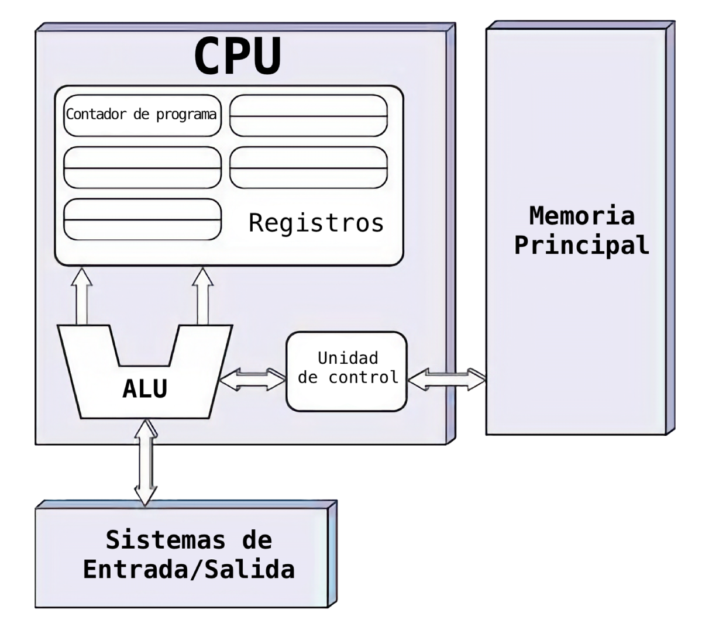
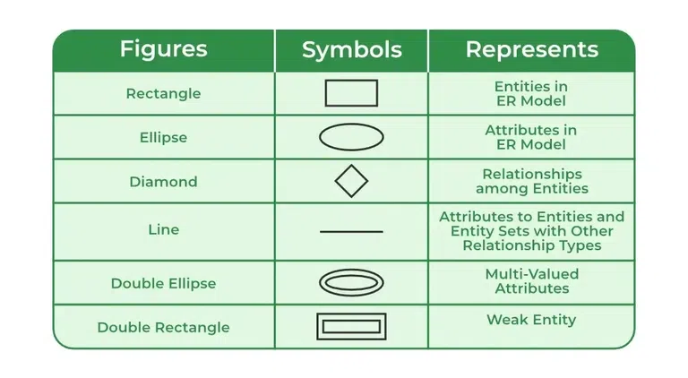
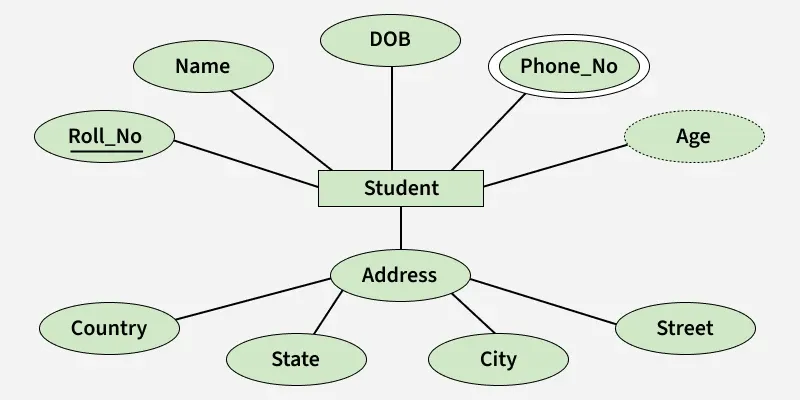
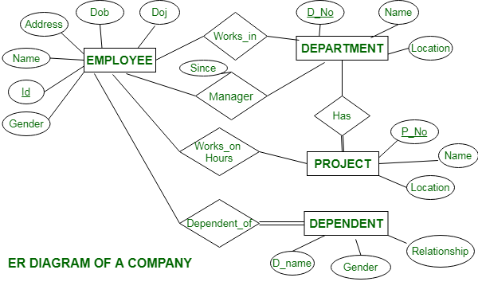
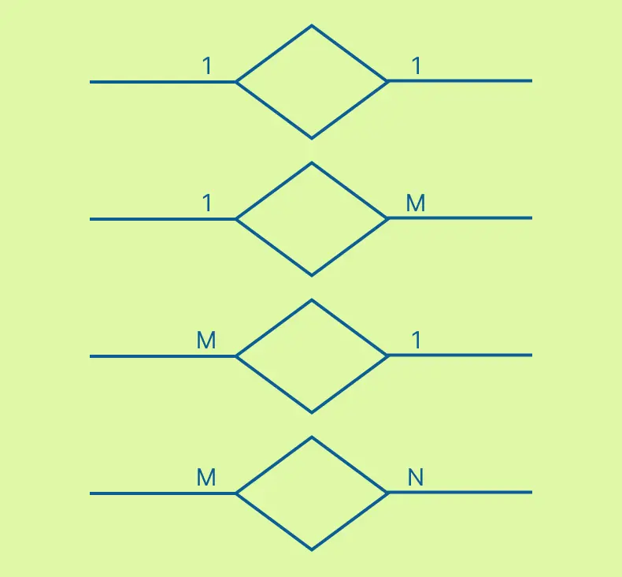
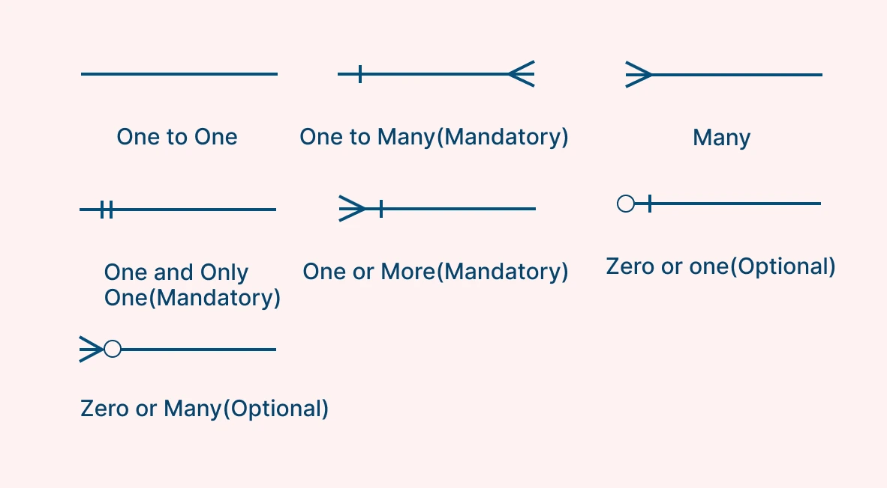

# Módulo Software - Clase 1

---

### Cuello de botella - John Von Neumann:

- Procesos paralelos corriendo en "cola".
- Limitación de velocidad en los ordenadores tradicionales donde la CPU (Unidad Central de Procesamiento) y la memoria comparten un único canal de comunicación (bus) para los datos y las instrucciones.



---

## Modelo Relacional

### ER diagram

- An ER diagram is a type of flowchart that illustrates how entities relate to each other within a system. They are also called ERDs or ER models.





#### Components:

- Entity: any kind of data object, such as a person, place, or thing.
- Relationship: define how entities act upon each other. They appear as diamonds or as labels on connecting lines.
- Attribute: define the properties of an entity. A descriptive attribute adds detail, and attribute categories include simple, composite, derived, and signle- or multi-value.
- Cardinality: defines the numeric attributes of a relationship. Common types of cardinality in an ER diagram are one-to-one, one-to-many, and many-to-many.
  - 
  - 

#### How to create a basic ER diagram:

Start with a plan and build the diagram one layer at a time. Follow these five steps to structure any ERD.

1. Define purpose and scope: Decide what system the diagram covers and why.
2. Identify entities: List the people, objects, and concepts the system tracks.
3. Add relationships: Connect the entities and label how they interact.
4. Add attributes: Attach the properties that describe each entity.
5. Set cardinality: Define the numeric rules for each relationship.

### Primary Key

1. A primary key has to be **unique** and identify only one record in our table.
2. It needs to be **never changing**.
3. A primary key needs to be **never null**.

### Foreign Key

- The same as a primary key, it's just located in a foreign place.

1. Unlike a primary key, a foreign key does not have to be unique. It **can be repeated** inside a table.
2. It's possible to have **multiple foreign keys** in **one entity**.

### Composite Primary Key:

- Are used when two or more attributes are necessary to uniquely identify every record.

1. Use the **fewest** number of attributes as possible.
2. **Don't** use attributes that are apt to change.

## XAMPP:

```sh
/Applications/XAMPP/xamppfiles/bin/mysql -u root
```

```sql
show databases;
```

```sql
use w3schools;
```

Show all tables:

```sql
show tables;
```

Describe the table `employees`:

```sql
desc employees;
```

### Select:

Select all columns from table `employees`:

```sql
select * from employees;
```

Select columns `LastName`, `FirstName` and `BirthDate` from table `employees`:

```sql
select LastName, FirstName, BirthDate from employees;
```

Enlists each `Country` from table `customers`:

```sql
select distinct Country from customers;
```

Enumerate the number of distinct `Country` from table `customers`:

```sql
select count(distinct Country) from customers;
```

Select all columns from `customers` where the `Country` is Mexico:

```sql
select * from customers where Country = "Mexico";
```

Select all colums from `customers` where `City` starts with `s`:

```sql
select * from customers where city LIKE 's%';
```

`AND`, `OR` & `NOT` Operators

```sql
select * from customers where Country = "Germany" AND City = "Berlin";
```

```sql
 select * from customers where NOT Country = "Germany";
```

`ORDER BY` `ASC|DESC`:

```sql
select * from customers order by Country;
```

```sql
select * from customers order by Country, CustomerName;
```

### Insert:

```sql
INSERT INTO table_name (column1, column2, column3, ...)
VALUES (value1, value2, value3, ...);
```

```sql
INSERT INTO customers (CustomerName, ContactName, Address, City, PostalCode, Country)
VALUES ("El borrego viudo", "Sr. Borrego Hdez", "Tlalpan 123", "Mexico City", 34348, "Mexico");
```

```sql
INSERT INTO customers (CustomerName, City, Country)
VALUES ("Don Asado", "Mexico City", "Mexico");
```

### Update:

```sql
UPDATE table_name
SET column1 = value1, column2 = value2, ...
WHERE condition;
```

```sql
UPDATE customers
SET ContactName = "Sr. Don Gutierrez", Address = "En mi corazón", PostalCode = 67670
WHERE CustomerID = 93;
```

### Delete:

```sql
DELETE FROM table_name WHERE condition;
```

```sql
DELETE FROM customers WHERE CustomerID = 93;
```

**⚠️ Delete database:**

```sql
drop database w3schools;
```

#### Limit & Offset:

```sql
select * from customers limit 3 offset 3;
```

### SQL Aggregate Functions:

```sql
select ProductName, MAX(Price) from Products;
```

```sql
select ProductName, Price from Products order by Price DESC limit 5;
```
