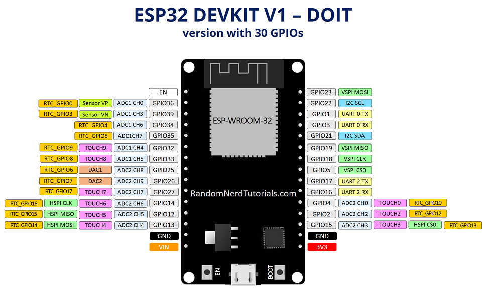
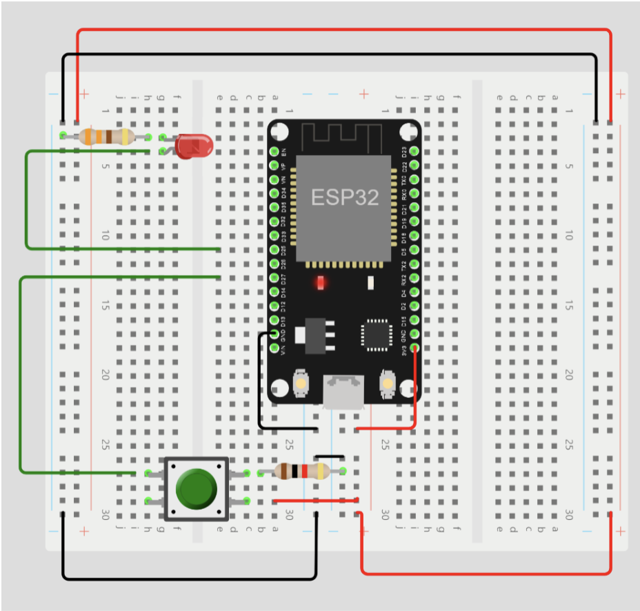
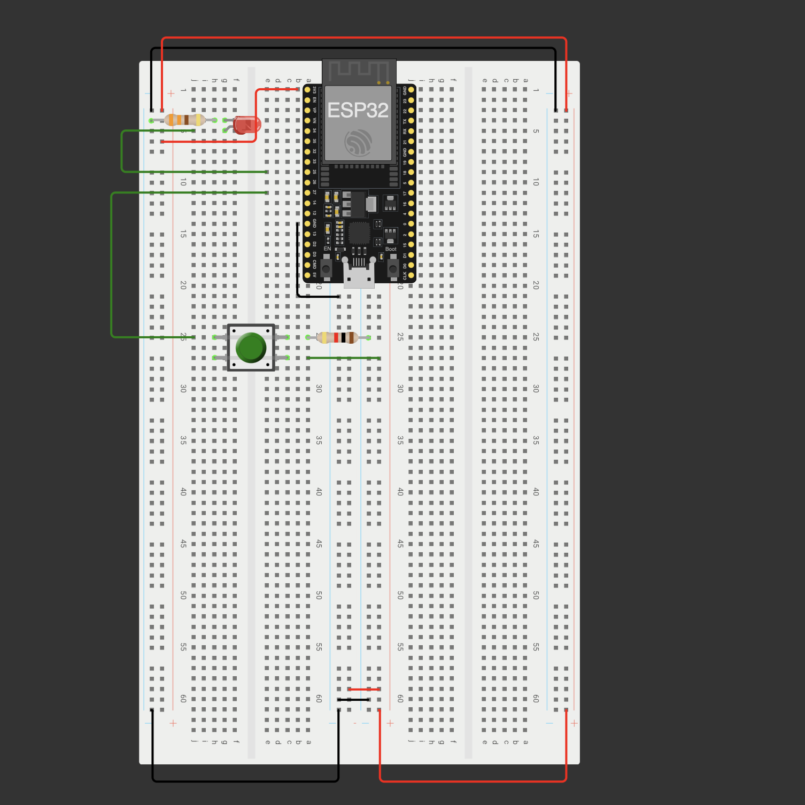

# Módulo Reto - Clase 1

---

## ESP32 DEVKIT V1



GPIO - General-Purpose Input/Output

**Pines que solo se pueden usar como entrada:**

- GPIO 34
- GPIO 35
- GPIO 36
- GPIO 39

**VIN es el único que entrega `5V`**

### Características del ESP-32:

- Wi-Fi 802.11 b/g/n
  - Bit rate 802.11 n hasta 150 Mb/s
  - Frecuencia central de operación 2412 a 2484 MHz
- Bluetooth
- Periféricos: SPI, UART, I2C, LED PWM, ADC
- Voltaje de operación: 3.3v
- Pines digitales I/O: 30
- Entradas analógicas: 16 canales con resolución de 12 bits ($2^{12} = 4096$)

---

## Entradas y salidas digitales

`digitalRead()` `digitalWrite()`

### Ejercicio 1:

Lectura y escritura digital

```ino
#define boton 27
#define LED1 25

void setup() {
    pinMode(boton, INPUT);
    pinMode(LED1, OUTPUT);
    digitalWrite(LED1, LOW);
    Serial.begin(115200);
}

void loop() {
    int lee = digitalRead(boton);
    if (lee == HIGH) {
        digitalWrite(LED1, HIGH);
        Serial.println("BOTON presionado");
    } else {
        digitalWrite(LED1, LOW);
    }
}
```



### [Práctica 1](https://wokwi.com/projects/476412364587970561)



```ino
#define boton 27
#define LED1 25

void setup() {
    pinMode(boton, INPUT);
    pinMode(LED1, OUTPUT);
    digitalWrite(LED1, LOW);
    Serial.begin(115200);
}

void loop() {
    int lee = digitalRead(boton);
    if (lee == HIGH) {
        digitalWrite(LED1, HIGH);
        Serial.println("BOTON presionado");
    } else {
        digitalWrite(LED1, LOW);
    }
}
```
