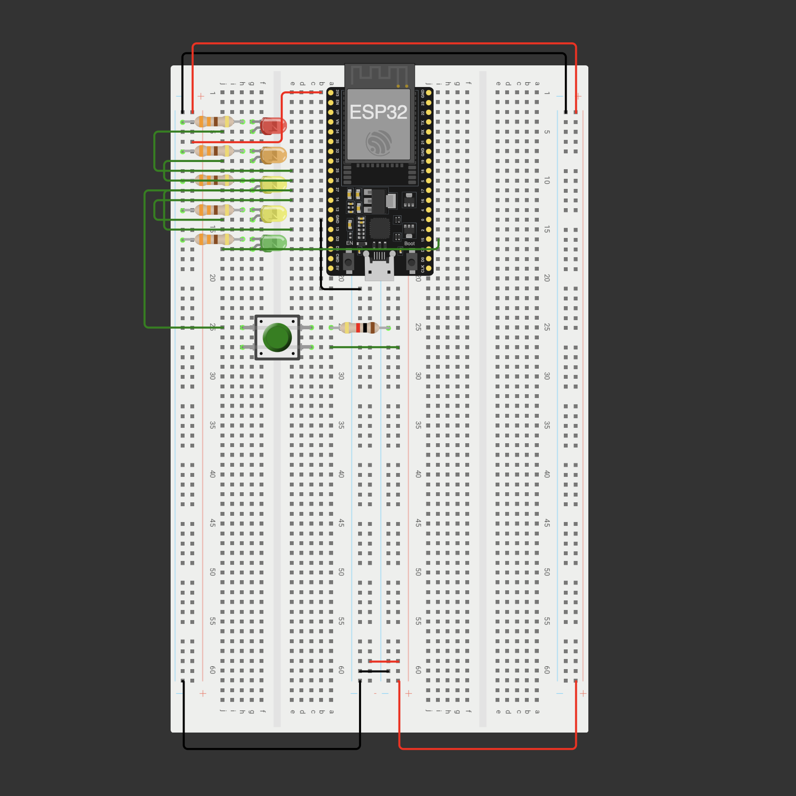
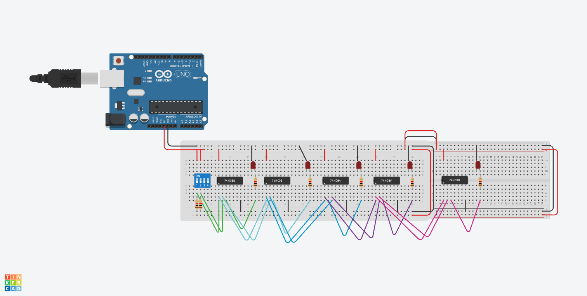

# Módulo Reto - Clase 2

---

## [Práctica 2](https://wokwi.com/projects/476415717938416641)



```ino

#define boton 27
#define LED1 25
#define LED2 26
#define LED3 13
#define LED4 14
#define LED5 15

void setup() {
    pinMode(boton, INPUT);
    pinMode(LED1, OUTPUT);
    pinMode(LED2, OUTPUT);
    pinMode(LED3, OUTPUT);
    pinMode(LED4, OUTPUT);
    pinMode(LED5, OUTPUT);
    Serial.begin(115200);
}

void loop() {
    int lee = digitalRead(boton);

    if (lee == HIGH) {
        Serial.println("BOTON presionado");
        digitalWrite(LED1, HIGH);
        delay(150);
        digitalWrite(LED2, HIGH);
        delay(150);
        digitalWrite(LED3, HIGH);
        delay(150);
        digitalWrite(LED4, HIGH);
        delay(150);
        digitalWrite(LED5, HIGH);
    } else {
        digitalWrite(LED1, LOW);
        digitalWrite(LED2, LOW);
        digitalWrite(LED3, LOW);
        digitalWrite(LED4, LOW);
        digitalWrite(LED5, LOW);
    }

    delay(100);
}
```

---

## [Práctica 3](https://www.tinkercad.com/things/d5uHgLKgFrF-iot-practica-1-compuertas-basicas/editel?returnTo=https%3A%2F%2Fwww.tinkercad.com%2Fdashboard&sharecode=couqF0zXbfOl9l2tdP4Q4IPqzkwJq3RuNEIOgV7b9vs)


