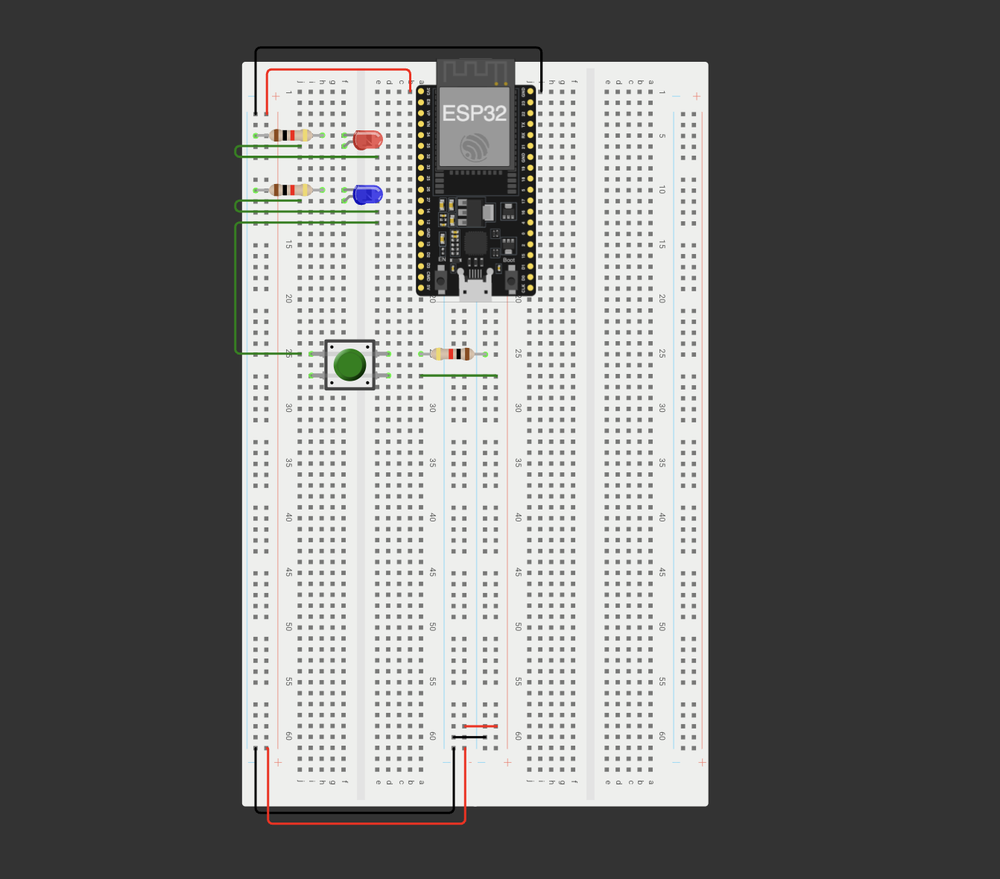
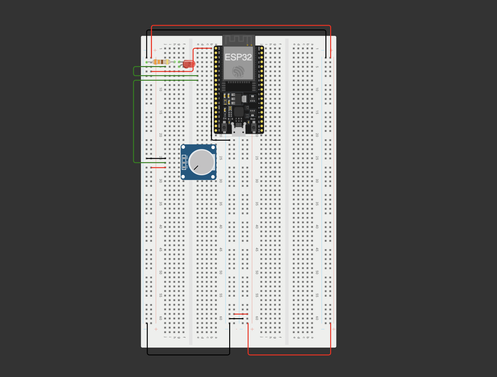

# Módulo Reto - Clase 3

---

## [Práctica 4](https://wokwi.com/projects/477047972117940225)

- LED que se mantenga encendido 5 segundos, luego se apaga 1 segundo.
- Otro LED que se encienda cuando se presiona un push button.



```ino
#define LED1 32
#define LED2 14
#define boton 12

double startMillis;
double currentMillis;

void setup() {
  Serial.begin(115200);
  pinMode(LED1, OUTPUT);
  pinMode(LED2, OUTPUT);
  digitalWrite(LED1, LOW);
  digitalWrite(LED2, LOW);
  startMillis = millis();
}

void loop() {
  currentMillis = millis();
  int lee = digitalRead(boton);
  if (lee == HIGH) {
      digitalWrite(LED2, HIGH);
      Serial.println("BOTON presionado");
  } else {
      digitalWrite(LED2, LOW);
  }

  if (currentMillis - startMillis >= 1000) {
    digitalWrite(LED1, HIGH);
  }

  if (currentMillis - startMillis >= 5000) {
    digitalWrite(LED1, LOW);
    startMillis = millis();
  }
}
```

```ino
#define LED1 32
#define LED2 14
#define boton 12

bool ledEncendido;

void IRAM_ATTR ManejoActuador() {
  digitalWrite(LED2, HIGH);
  ledEncendido = true;
}

void setup() {
  pinMode(LED1, OUTPUT);
  pinMode(LED2, OUTPUT);
  attachInterrupt(digitalPinToInterrupt(boton), ManejoActuador, RISING);
}

void loop() {

  if (ledEncendido) {
    digitalWrite(LED2, LOW);
    ledEncendido = false;
  }

  digitalWrite(LED1, HIGH);
  delay(5000);
  digitalWrite(LED1, LOW);
  delay(1000);
}
```

## [Práctica 5](https://wokwi.com/projects/477055241195293697)



```ino
#define POT_PIN 33
#define LED 32

void setup() {
    pinMode(LED, OUTPUT);
    Serial.begin(115200);
}

void loop() {
    int lecturaADC = analogRead(POT_PIN);
    float voltaje = (lecturaADC * 3.3) / 4095.0;
    Serial.println(voltaje);
    analogWrite(LED, lecturaADC);
}
```
