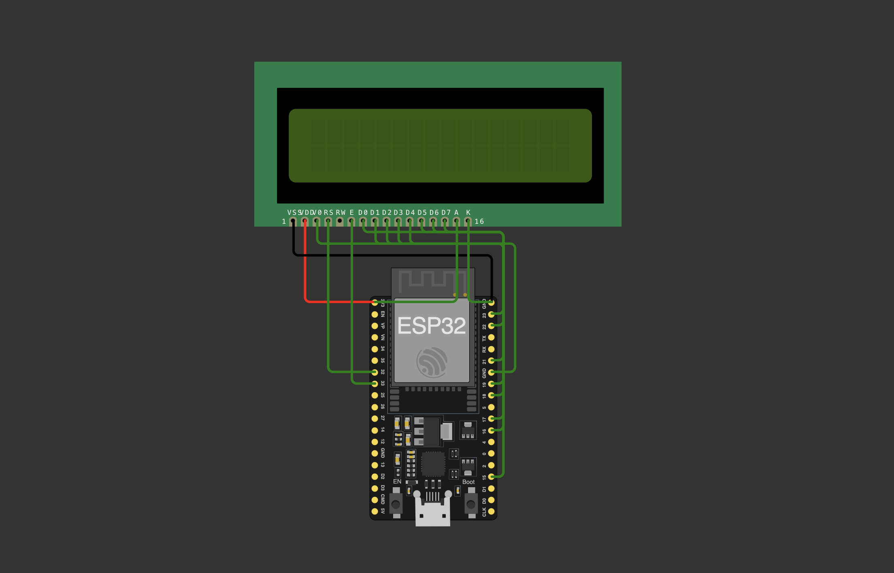
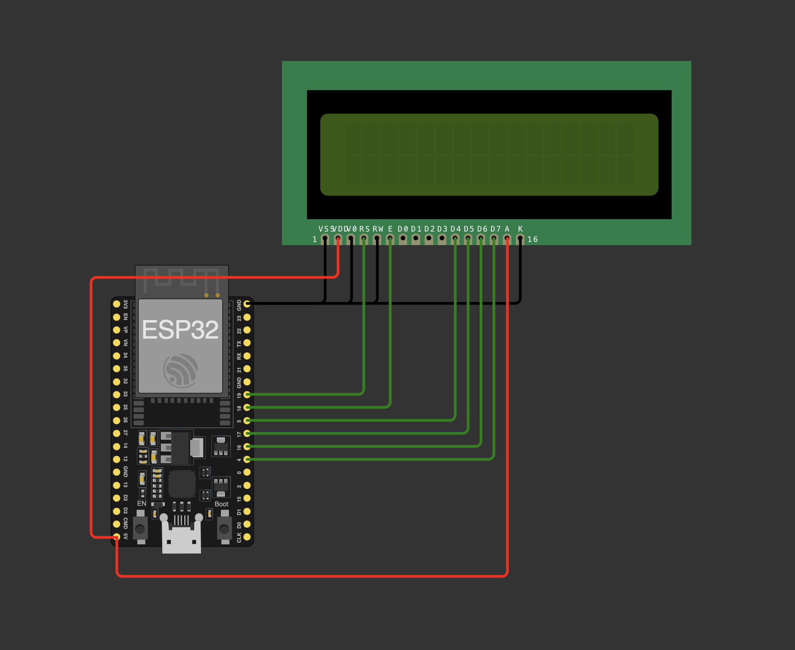

# Módulo Reto - Clase 4

---

## [Práctica 6](https://wokwi.com/projects/477693323548109825)

### LCD:

#### 16 pines:

- VS - GND
- SVD - Alimentación
- DV0 - Contraste del display (al conectar a GND es máx.)
- RS (Write/Setting) (1/0)
- RW (Read/Write) (1/0)
- E (Enable)
- D0
- D1
- D2
- D3
- D4
- D5
- D6
- D7
- A (Anode)
- K (Cathode)



```ino
#define D0 15
#define D1 16
#define D2 17
#define D3 18
#define D4 19
#define D5 21
#define D6 22
#define D7 23
#define Enable 33
#define RS 32

void setup() {
  Serial.begin(115200);
  pinMode(D0, OUTPUT);
  pinMode(D1, OUTPUT);
  pinMode(D2, OUTPUT);
  pinMode(D3, OUTPUT);
  pinMode(D4, OUTPUT);
  pinMode(D5, OUTPUT);
  pinMode(D6, OUTPUT);
  pinMode(D7, OUTPUT);
  pinMode(Enable, OUTPUT);
  pinMode(RS, OUTPUT);

  digitalWrite(RS, LOW);
  digitalWrite(Enable, LOW);

  //Inicialización
  digitalWrite(RS,LOW);
  digitalWrite(D0,LOW);
  digitalWrite(D1,LOW);
  digitalWrite(D2,LOW);
  digitalWrite(D3,HIGH);
  digitalWrite(D4,HIGH);
  digitalWrite(D5,HIGH);
  digitalWrite(D6,LOW);
  digitalWrite(D7,LOW);

  digitalWrite(Enable, HIGH);
  delay(40);
  digitalWrite(Enable, LOW);

  //Encendido
  digitalWrite(RS,LOW);
  digitalWrite(D0,LOW);
  digitalWrite(D1,LOW);
  digitalWrite(D2,HIGH);
  digitalWrite(D3,HIGH);
  digitalWrite(D4,LOW);
  digitalWrite(D5,LOW);
  digitalWrite(D6,LOW);
  digitalWrite(D7,LOW);

  digitalWrite(Enable, HIGH);
  delay(.1);
  digitalWrite(Enable, LOW);

  //Limpiado
  digitalWrite(D0,HIGH);
  digitalWrite(D1,LOW);
  digitalWrite(D2,LOW);
  digitalWrite(D3,LOW);
  digitalWrite(D4,LOW);
  digitalWrite(D5,LOW);
  digitalWrite(D6,LOW);
  digitalWrite(D7,LOW);

  digitalWrite(Enable, HIGH);
  delay(.1);
  digitalWrite(Enable, LOW);

  //Escritura
  digitalWrite(RS, HIGH);
  digitalWrite(D0,HIGH);
  digitalWrite(D1,LOW);
  digitalWrite(D2,HIGH);
  digitalWrite(D3,HIGH);
  digitalWrite(D4,LOW);
  digitalWrite(D5,LOW);
  digitalWrite(D6,HIGH);
  digitalWrite(D7,LOW);
  digitalWrite(Enable, HIGH);
  digitalWrite(Enable, LOW);
  digitalWrite(D0,LOW);
  digitalWrite(D1,LOW);
  digitalWrite(D2,HIGH);
  digitalWrite(D3,LOW);
  digitalWrite(D4,HIGH);
  digitalWrite(D5,LOW);
  digitalWrite(D6,HIGH);
  digitalWrite(D7,LOW);
  digitalWrite(Enable, HIGH);
  digitalWrite(Enable, LOW);
  digitalWrite(D0,LOW);
  digitalWrite(D1,HIGH);
  digitalWrite(D2,HIGH);
  digitalWrite(D3,LOW);
  digitalWrite(D4,LOW);
  digitalWrite(D5,LOW);
  digitalWrite(D6,HIGH);
  digitalWrite(D7,LOW);
  digitalWrite(Enable, HIGH);
  digitalWrite(Enable, LOW);
  digitalWrite(RS,LOW);
  for(int i = 0;i<3;i++){
    digitalWrite(Enable, LOW);
    digitalWrite(D0,LOW);
    digitalWrite(D1,LOW);
    digitalWrite(D2,HIGH);
    digitalWrite(D3,LOW);
    digitalWrite(D4,HIGH);
    digitalWrite(D5,LOW);
    digitalWrite(D6,LOW);
    digitalWrite(D7,LOW);
    digitalWrite(Enable, HIGH);
  }
  digitalWrite(RS,HIGH);

  digitalWrite(Enable, LOW);

  digitalWrite(D0,HIGH);
  digitalWrite(D1,HIGH);
  digitalWrite(D2,LOW);
  digitalWrite(D3,LOW);
  digitalWrite(D4,HIGH);
  digitalWrite(D5,LOW);
  digitalWrite(D6,HIGH);
  digitalWrite(D7,LOW);
  digitalWrite(Enable, HIGH);
  digitalWrite(Enable, LOW);
  digitalWrite(D0,HIGH);
  digitalWrite(D1,HIGH);
  digitalWrite(D2,LOW);
  digitalWrite(D3,LOW);
  digitalWrite(D4,LOW);
  digitalWrite(D5,LOW);
  digitalWrite(D6,HIGH);
  digitalWrite(D7,LOW);
  digitalWrite(Enable, HIGH);
  digitalWrite(Enable, LOW);
  digitalWrite(D0,LOW);
  digitalWrite(D1,LOW);
  digitalWrite(D2,HIGH);
  digitalWrite(D3,LOW);
  digitalWrite(D4,HIGH);
  digitalWrite(D5,LOW);
  digitalWrite(D6,HIGH);
  digitalWrite(D7,LOW);
  digitalWrite(Enable,HIGH);
  digitalWrite(Enable, LOW);

  digitalWrite(RS,LOW);

  digitalWrite(D0,LOW);
  digitalWrite(D1,LOW);
  digitalWrite(D2,LOW);
  digitalWrite(D3,LOW);
  digitalWrite(D4,LOW);
  digitalWrite(D5,LOW);
  digitalWrite(D6,HIGH);
  digitalWrite(D7,HIGH);
  digitalWrite(Enable,HIGH);
  digitalWrite(Enable, LOW);
  digitalWrite(RS,HIGH);

  digitalWrite(D0,LOW);
  digitalWrite(D1,LOW);
  digitalWrite(D2,HIGH);
  digitalWrite(D3,LOW);
  digitalWrite(D4,LOW);
  digitalWrite(D5,LOW);
  digitalWrite(D6,HIGH);
  digitalWrite(D7,LOW);
  digitalWrite(Enable, HIGH);
  digitalWrite(Enable, LOW);
  digitalWrite(D0,LOW);
  digitalWrite(D1,HIGH);
  digitalWrite(D2,HIGH);
  digitalWrite(D3,LOW);
  digitalWrite(D4,LOW);
  digitalWrite(D5,LOW);
  digitalWrite(D6,HIGH);
  digitalWrite(D7,LOW);
  digitalWrite(Enable, HIGH);
  digitalWrite(Enable, LOW);
  digitalWrite(D0,HIGH);
  digitalWrite(D1,LOW);
  digitalWrite(D2,LOW);
  digitalWrite(D3,LOW);
  digitalWrite(D4,LOW);
  digitalWrite(D5,LOW);
  digitalWrite(D6,HIGH);
  digitalWrite(D7,LOW);
  digitalWrite(Enable,HIGH);
  digitalWrite(Enable, LOW);

  digitalWrite(RS,LOW);
  for(int i = 0;i<3;i++){
    digitalWrite(Enable, LOW);
    digitalWrite(D0,LOW);
    digitalWrite(D1,LOW);
    digitalWrite(D2,HIGH);
    digitalWrite(D3,LOW);
    digitalWrite(D4,HIGH);
    digitalWrite(D5,LOW);
    digitalWrite(D6,LOW);
    digitalWrite(D7,LOW);
    digitalWrite(Enable, HIGH);
  }
  digitalWrite(RS,HIGH);

  digitalWrite(Enable,LOW);
  digitalWrite(D0,LOW);
  digitalWrite(D1,LOW);
  digitalWrite(D2,HIGH);
  digitalWrite(D3,LOW);
  digitalWrite(D4,LOW);
  digitalWrite(D5,LOW);
  digitalWrite(D6,HIGH);
  digitalWrite(D7,LOW);
  digitalWrite(Enable, HIGH);
  digitalWrite(Enable, LOW);
  digitalWrite(D0,LOW);
  digitalWrite(D1,HIGH);
  digitalWrite(D2,HIGH);
  digitalWrite(D3,LOW);
  digitalWrite(D4,LOW);
  digitalWrite(D5,LOW);
  digitalWrite(D6,HIGH);
  digitalWrite(D7,LOW);
  digitalWrite(Enable, HIGH);
  digitalWrite(Enable, LOW);
  digitalWrite(D0,HIGH);
  digitalWrite(D1,LOW);
  digitalWrite(D2,LOW);
  digitalWrite(D3,LOW);
  digitalWrite(D4,LOW);
  digitalWrite(D5,LOW);
  digitalWrite(D6,HIGH);
  digitalWrite(D7,LOW);
  digitalWrite(Enable,HIGH);
  digitalWrite(Enable, LOW);
}

void loop() {
  digitalWrite(RS, LOW);
  digitalWrite(Enable, LOW);

  //Inicialización
  digitalWrite(RS,LOW);
  digitalWrite(D0,LOW);
  digitalWrite(D1,LOW);
  digitalWrite(D2,HIGH);
  digitalWrite(D3,HIGH);
  digitalWrite(D4,HIGH);
  digitalWrite(D5,LOW);
  digitalWrite(D6,LOW);
  digitalWrite(D7,LOW);
  digitalWrite(Enable, HIGH);
  delay(100);

}
```

## [Práctica 7](https://wokwi.com/projects/477692547202137089)



```ino

#define D4 5
#define D5 17
#define D6 16
#define D7 4
#define Enable 18
#define RS 19

void setup() {
  pinMode(D4, OUTPUT);
  pinMode(D5, OUTPUT);
  pinMode(D6, OUTPUT);
  pinMode(D7, OUTPUT);
  pinMode(Enable, OUTPUT);
  pinMode(RS, OUTPUT);

  digitalWrite(RS, LOW);
  digitalWrite(Enable, LOW);
  delay(50);

  // Inicialización
  for (int i = 0; i < 3; i++) {
    digitalWrite(D4, HIGH);
    digitalWrite(D5, HIGH);
    digitalWrite(D6, LOW);
    digitalWrite(D7, LOW);
    digitalWrite(Enable, HIGH);
    delay(5);
    digitalWrite(Enable, LOW);
    delay(5);
  }

  // Modo de 4 bits
  digitalWrite(D4, LOW);
  digitalWrite(D5, HIGH);
  digitalWrite(D6, LOW);
  digitalWrite(D7, LOW);
  digitalWrite(Enable, HIGH);
  delay(5);
  digitalWrite(Enable, LOW);

  // Configurar 2 líneas (0x28)
  digitalWrite(D4, LOW);
  digitalWrite(D5, LOW);
  digitalWrite(D6, HIGH);
  digitalWrite(D7, LOW);
  digitalWrite(Enable, HIGH);
  delay(1);
  digitalWrite(Enable, LOW);

  digitalWrite(D4, LOW);
  digitalWrite(D5, LOW);
  digitalWrite(D6, LOW);
  digitalWrite(D7, HIGH);
  digitalWrite(Enable, HIGH);
  delay(1);
  digitalWrite(Enable, LOW);

  // Encender pantalla
  digitalWrite(D4, LOW);
  digitalWrite(D5, LOW);
  digitalWrite(D6, LOW);
  digitalWrite(D7, LOW);
  digitalWrite(Enable, HIGH);
  delay(1);
  digitalWrite(Enable, LOW);

  digitalWrite(D4, LOW);
  digitalWrite(D5, LOW);
  digitalWrite(D6, HIGH);
  digitalWrite(D7, HIGH);
  digitalWrite(Enable, HIGH);
  delay(1);
  digitalWrite(Enable, LOW);

  // Avanzar cursor
  digitalWrite(D4, LOW);
  digitalWrite(D5, LOW);
  digitalWrite(D6, LOW);
  digitalWrite(D7, LOW);
  digitalWrite(Enable, HIGH);
  delay(1);
  digitalWrite(Enable, LOW);

  digitalWrite(D4, LOW);
  digitalWrite(D5, HIGH);
  digitalWrite(D6, HIGH);
  digitalWrite(D7, LOW);
  digitalWrite(Enable, HIGH);
  delay(1);
  digitalWrite(Enable, LOW);
}

void loop() {
  // Limpiar pantalla
  digitalWrite(RS, LOW);

  digitalWrite(D4, LOW);
  digitalWrite(D5, LOW);
  digitalWrite(D6, LOW);
  digitalWrite(D7, LOW);
  digitalWrite(Enable, HIGH);
  delay(1);
  digitalWrite(Enable, LOW);

  digitalWrite(D4, HIGH);
  digitalWrite(D5, LOW);
  digitalWrite(D6, LOW);
  digitalWrite(D7, LOW);
  digitalWrite(Enable, HIGH);
  delay(2);
  digitalWrite(Enable, LOW);

  digitalWrite(RS, HIGH);

  // S
  digitalWrite(D4, HIGH);
  digitalWrite(D5, LOW);
  digitalWrite(D6, HIGH);
  digitalWrite(D7, LOW);
  digitalWrite(Enable, HIGH);
  delay(1);
  digitalWrite(Enable, LOW);

  digitalWrite(D4, HIGH);
  digitalWrite(D5, HIGH);
  digitalWrite(D6, LOW);
  digitalWrite(D7, LOW);
  digitalWrite(Enable, HIGH);
  delay(1);
  digitalWrite(Enable, LOW);
  delay(300);

  // C
  digitalWrite(D4, LOW);
  digitalWrite(D5, LOW);
  digitalWrite(D6, HIGH);
  digitalWrite(D7, LOW);
  digitalWrite(Enable, HIGH);
  delay(1);
  digitalWrite(Enable, LOW);

  digitalWrite(D4, HIGH);
  digitalWrite(D5, HIGH);
  digitalWrite(D6, LOW);
  digitalWrite(D7, LOW);
  digitalWrite(Enable, HIGH);
  delay(1);
  digitalWrite(Enable, LOW);
  delay(300);

  // T
  digitalWrite(D4, HIGH);
  digitalWrite(D5, LOW);
  digitalWrite(D6, HIGH);
  digitalWrite(D7, LOW);
  digitalWrite(Enable, HIGH);
  delay(1);
  digitalWrite(Enable, LOW);

  digitalWrite(D4, LOW);
  digitalWrite(D5, LOW);
  digitalWrite(D6, HIGH);
  digitalWrite(D7, LOW);
  digitalWrite(Enable, HIGH);
  delay(1);
  digitalWrite(Enable, LOW);
  delay(300);

  // Espacio
  digitalWrite(D4, LOW);
  digitalWrite(D5, HIGH);
  digitalWrite(D6, LOW);
  digitalWrite(D7, LOW);
  digitalWrite(Enable, HIGH);
  delay(1);
  digitalWrite(Enable, LOW);

  digitalWrite(D4, LOW);
  digitalWrite(D5, LOW);
  digitalWrite(D6, LOW);
  digitalWrite(D7, LOW);
  digitalWrite(Enable, HIGH);
  delay(1);
  digitalWrite(Enable, LOW);

  // D
  digitalWrite(D4, LOW);
  digitalWrite(D5, LOW);
  digitalWrite(D6, HIGH);
  digitalWrite(D7, LOW);
  digitalWrite(Enable, HIGH);
  delay(1);
  digitalWrite(Enable, LOW);

  digitalWrite(D4, LOW);
  digitalWrite(D5, LOW);
  digitalWrite(D6, HIGH);
  digitalWrite(D7, LOW);
  digitalWrite(Enable, HIGH);
  delay(1);
  digitalWrite(Enable, LOW);
  delay(300);

  // F
  digitalWrite(D4, LOW);
  digitalWrite(D5, LOW);
  digitalWrite(D6, HIGH);
  digitalWrite(D7, LOW);
  digitalWrite(Enable, HIGH);
  delay(1);
  digitalWrite(Enable, LOW);

  digitalWrite(D4, LOW);
  digitalWrite(D5, HIGH);
  digitalWrite(D6, HIGH);
  digitalWrite(D7, LOW);
  digitalWrite(Enable, HIGH);
  delay(1);
  digitalWrite(Enable, LOW);
  delay(300);

  // A
  digitalWrite(D4, LOW);
  digitalWrite(D5, LOW);
  digitalWrite(D6, HIGH);
  digitalWrite(D7, LOW);
  digitalWrite(Enable, HIGH);
  delay(1);
  digitalWrite(Enable, LOW);

  digitalWrite(D4, HIGH);
  digitalWrite(D5, LOW);
  digitalWrite(D6, LOW);
  digitalWrite(D7, LOW);
  digitalWrite(Enable, HIGH);
  delay(1);
  digitalWrite(Enable, LOW);
  delay(300);

  // Segunda línea
  digitalWrite(RS, LOW);

  digitalWrite(D4, LOW);
  digitalWrite(D5, LOW);
  digitalWrite(D6, HIGH);
  digitalWrite(D7, HIGH);
  digitalWrite(Enable, HIGH);
  delay(1);
  digitalWrite(Enable, LOW);

  digitalWrite(D4, LOW);
  digitalWrite(D5, LOW);
  digitalWrite(D6, LOW);
  digitalWrite(D7, LOW);
  digitalWrite(Enable, HIGH);
  delay(1);
  digitalWrite(Enable, LOW);

  digitalWrite(RS, HIGH);

  // MTF MTF
  for (int repetir = 0; repetir < 2; repetir++) {

    // M
    digitalWrite(D4, LOW);
    digitalWrite(D5, LOW);
    digitalWrite(D6, HIGH);
    digitalWrite(D7, LOW);
    digitalWrite(Enable, HIGH);
    delay(1);
    digitalWrite(Enable, LOW);

    digitalWrite(D4, HIGH);
    digitalWrite(D5, LOW);
    digitalWrite(D6, HIGH);
    digitalWrite(D7, HIGH);
    digitalWrite(Enable, HIGH);
    delay(1);
    digitalWrite(Enable, LOW);
    delay(300);

    // T
    digitalWrite(D4, HIGH);
    digitalWrite(D5, LOW);
    digitalWrite(D6, HIGH);
    digitalWrite(D7, LOW);
    digitalWrite(Enable, HIGH);
    delay(1);
    digitalWrite(Enable, LOW);

    digitalWrite(D4, LOW);
    digitalWrite(D5, LOW);
    digitalWrite(D6, HIGH);
    digitalWrite(D7, LOW);
    digitalWrite(Enable, HIGH);
    delay(1);
    digitalWrite(Enable, LOW);
    delay(300);

    // F
    digitalWrite(D4, LOW);
    digitalWrite(D5, LOW);
    digitalWrite(D6, HIGH);
    digitalWrite(D7, LOW);
    digitalWrite(Enable, HIGH);
    delay(1);
    digitalWrite(Enable, LOW);

    digitalWrite(D4, LOW);
    digitalWrite(D5, HIGH);
    digitalWrite(D6, HIGH);
    digitalWrite(D7, LOW);
    digitalWrite(Enable, HIGH);
    delay(1);
    digitalWrite(Enable, LOW);
    delay(300);

    // Espacio entre MTF y MTF
    if (repetir == 0) {
      digitalWrite(D4, LOW);
      digitalWrite(D5, HIGH);
      digitalWrite(D6, LOW);
      digitalWrite(D7, LOW);
      digitalWrite(Enable, HIGH);
      delay(1);
      digitalWrite(Enable, LOW);

      digitalWrite(D4, LOW);
      digitalWrite(D5, LOW);
      digitalWrite(D6, LOW);
      digitalWrite(D7, LOW);
      digitalWrite(Enable, HIGH);
      delay(1);
      digitalWrite(Enable, LOW);
    }
  }

  delay(2000);
}
```
